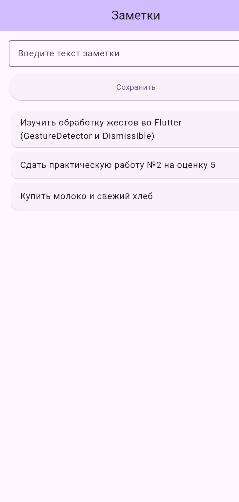
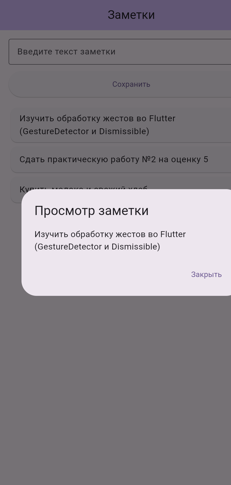
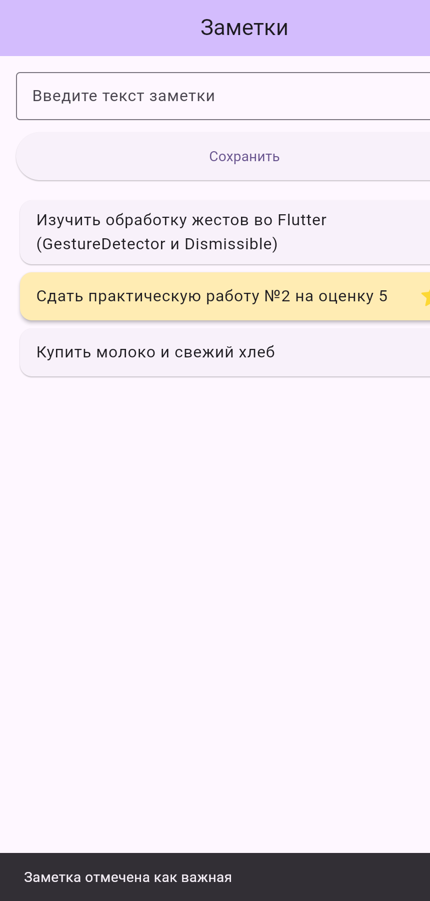
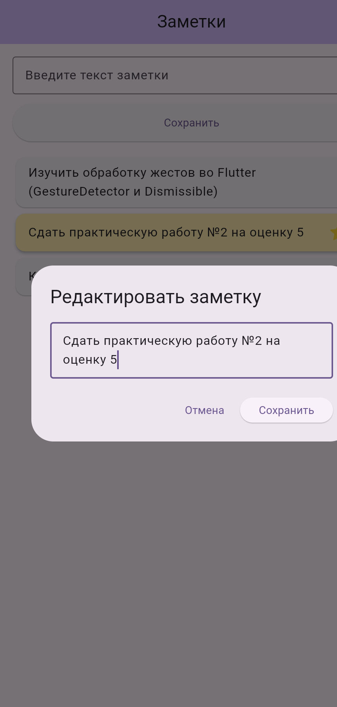
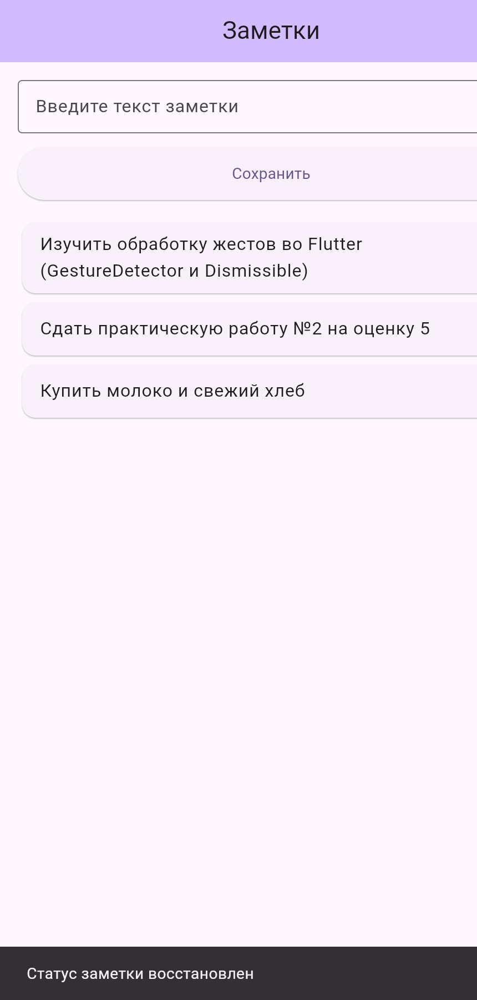
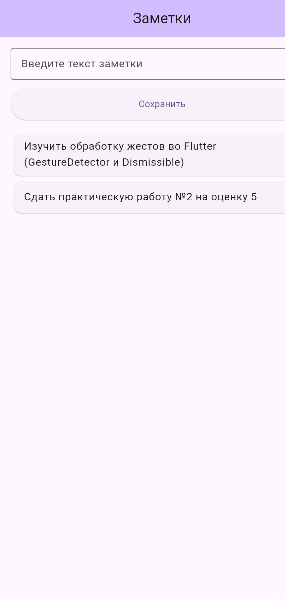
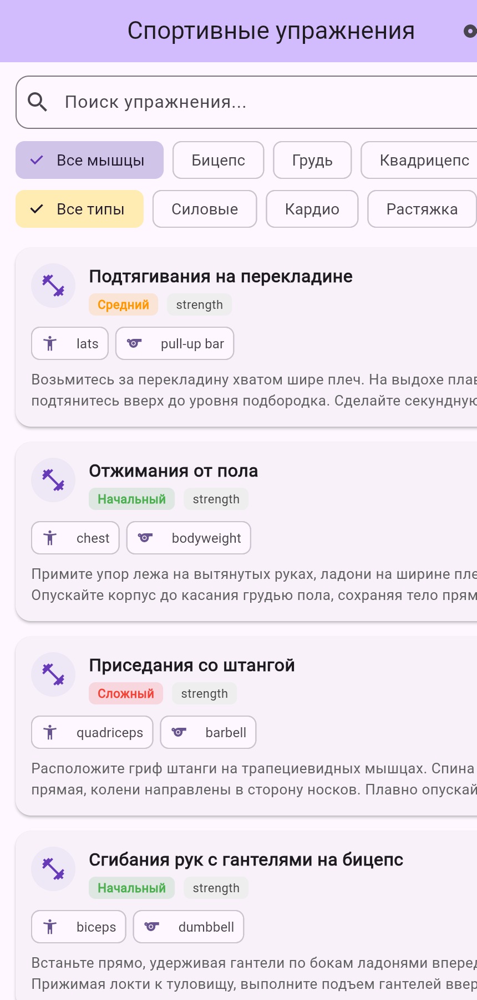
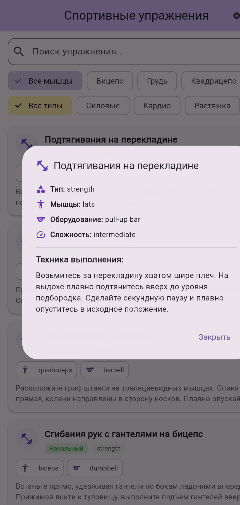
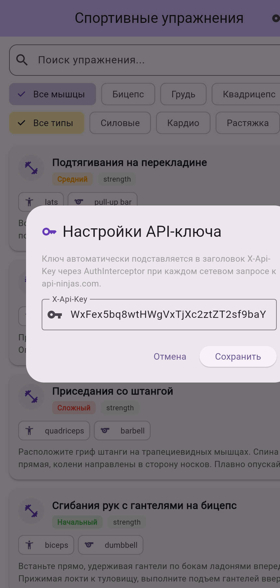
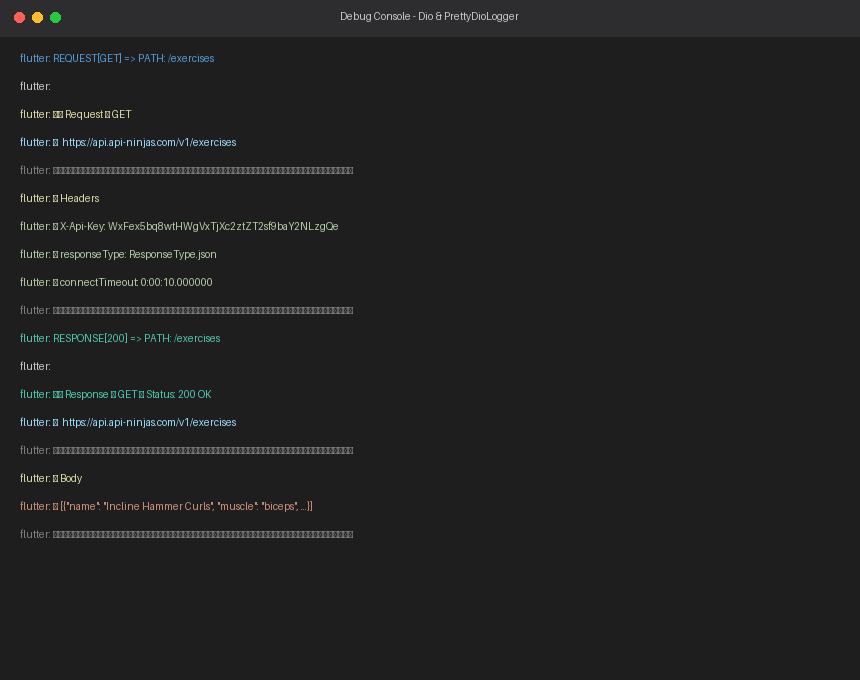

# Практические работы по разработке на Flutter

В данном репозитории содержатся практические работы по дисциплине «Разработка мобильных приложений на Flutter»:

1. **[flutter_application_1](flutter_application_1/)** - Практическая работа №1: верстка базовых экранов (приветственный экран, популярное меню, медитация, органайзер).
2. **[flutter_application_2](flutter_application_2/)** - Практическая работа №2: базовое приложение «Заметки» (ввод, добавление в список, редактирование и удаление через кнопки).
3. **[flutter_application_3](flutter_application_3/)** - Практическая работа №3: доработка приложения «Заметки» с поддержкой жестов (GestureDetector и Dismissible) на оценку 5.
4. **[flutter_application_4](flutter_application_4/)** - Практическая работа №4: работа с сетью во Flutter (Dio, Interceptors, PrettyDioLogger, GetIt) на оценку 5.

---

# Практическая работа №3. Обработка жестов во Flutter (GestureDetector и Dismissible)

Данный проект представляет собой мобильное приложение «Заметки» на Flutter с расширенной интерактивностью и поддержкой пользовательских жестов. Работа выполнена на оценку 5 в строгом соответствии с материалами лекции «GestureDetector и обработка жестов во Flutter».

---

## Реализованная функциональность

### Критерии на оценку 4:
- **Обычное нажатие (onTap)** - открывает диалоговое окно для просмотра полного текста выбранной заметки.
- **Двойное нажатие (onDoubleTap)** - отмечает заметку как важную: карточка подсвечивается янтарным цветом, добавляется значок ⭐ и отображается всплывающее уведомление.

### Критерии на оценку 5:
- **Долгое нажатие (onLongPress)** - открывает диалоговое окно редактирования заметки. После сохранения текст заметки корректно обновляется в списке.
- **Свайп влево (swipe left / endToStart)** - удаляет заметку из списка с плавной анимацией смахивания и красным фоновым индикатором удаления.
- **Свайп вправо (swipe right / startToEnd)** - восстанавливает обычный статус заметки, если она была отмечена как важная (снимает отметку ⭐ и возвращает стандартный цвет карточки).

---

## Архитектура и используемые виджеты

В соответствии с рекомендациями лекционного материала (в частности, слайд 14 о разрешении конфликтов жестов):
1. **GestureDetector** - используется для отслеживания дискретных жестов взаимодействия с карточкой заметки:
   - `onTap`: вызов окна просмотра полного содержимого;
   - `onDoubleTap`: установка признака важной заметки (`isImportant = true`);
   - `onLongPress`: открытие модального окна для изменения текста заметки.
2. **Dismissible** - специализированный виджет Flutter для горизонтальных свайпов в `ListView` (рекомендован на слайде 14 во избежание конфликтов между скроллом списка и свайпами карточек):
   - `direction: DismissDirection.horizontal`: поддержка движений влево и вправо;
   - `background`: зеленая панель с иконкой восстановления и надписью «Обычный статус» при свайпе вправо;
   - `secondaryBackground`: красная панель с иконкой корзины и надписью «Удалить» при свайпе влево;
   - `confirmDismiss`: ветвление логики в зависимости от направления свайпа (свайп влево подтверждает удаление, свайп вправо сбрасывает важность и возвращает карточку на место).
3. **Модель данных Note**:
   - `String id`: уникальный идентификатор элемента;
   - `String text`: текст заметки;
   - `bool isImportant`: статус важности заметки.

---

## Пошаговое описание действий и демонстрация результатов

### 1. Главный экран приложения
Пользователь может вводить текст заметки в текстовое поле и нажимать кнопку «Сохранить». Заметки добавляются в интерактивный список `ListView.builder`.

### 2. Просмотр заметки по обычному нажатию (onTap)
При коротком нажатии (`onTap`) на любую карточку открывается модальное окно с заголовком «Просмотр заметки», полным текстом и кнопкой закрытия.

### 3. Отметка заметки как важной по двойному нажатию (onDoubleTap)
При двойном нажатии (`onDoubleTap`) заметка переводится в статус важной: фон карточки подсвечивается мягким янтарным цветом, в правом углу появляется значок ⭐, а внизу экрана отображается SnackBar «Заметка отмечена как важная».

### 4. Редактирование заметки по долгому нажатию (onLongPress)
При удержании пальца на карточке (`onLongPress`) открывается диалоговое окно «Редактировать заметку» с текстовым полем, в которое уже подставлен текущий текст. Пользователь может скорректировать формулировку и нажать «Сохранить». Текст в списке мгновенно обновляется.

### 5. Восстановление обычного статуса по свайпу вправо
При горизонтальном смахивании карточки вправо срабатывает жест свайпа. Заметка сбрасывает статус важной (`isImportant = false`), карточка возвращает исходный стандартный цвет, значок ⭐ убирается, и появляется информационное сообщение «Статус заметки восстановлен».

### 6. Удаление заметки по свайпу влево
При смахивании карточки влево открывается красный фон с иконкой корзины. Карточка удаляется из списка с плавной анимацией виджета `Dismissible`.

---

# Практическая работа №4. Работа с сетью во Flutter (Dio, Interceptors, PrettyDioLogger, GetIt)

Данный проект представляет собой мобильное приложение на Flutter для поиска и просмотра спортивных упражнений с интеграцией внешнего REST API (API Ninjas Exercises API). Работа выполнена на оценку 5 в строгом соответствии с требованиями практической работы и материалами лекции «Работа с сетью при помощи пакета Dio».

---

## Реализованная функциональность

### Критерии на оценку 3:
- Разработано полноценное мобильное приложение, взаимодействующее с сетью.
- Для отправки HTTP-запросов и обработки ответов используется пакет `dio` (версия 5.x).

### Критерии на оценку 4:
- Создан собственный класс интерцептора `AuthInterceptor extends Interceptor`, который автоматически перехватывает исходящие запросы и внедряет авторизационный заголовок `X-Api-Key` с токеном доступа.
- Подключен и настроен форматированный логгер сетевых запросов и ответов из пакета `pretty_dio_logger` (с отображением заголовков, тела запроса, статус-кодов и ответов сервера).

### Критерии на оценку 5:
- Для выполнения сетевых запросов применен пакет `dio`.
- Реализован класс `AuthInterceptor` для централизованного добавления токена авторизации в HTTP-заголовки.
- Интегрирован интерцептор `PrettyDioLogger` для красивого и информативного вывода сетевой активности в консоль, а также кастомный `LoggingInterceptor`.
- Для управления зависимостями (Dependency Injection / Service Locator) используется пакет `get_it`. Все сетевые клиенты, интерцепторы и сервисы регистрируются в едином контейнере `GetIt.instance`.
- В качестве источника данных используется REST API сервиса `https://api-ninjas.com` (раздел Exercises API: `https://api.api-ninjas.com/v1/exercises`).
- Приложение обладает развитой функциональностью: поиск упражнений по названию, фильтрация по задействованным группам мышц (biceps, chest, abdominals, legs и др.), фильтрация по типу тренировки (strength, cardio, stretching и др.), карточки упражнений с бейджами сложности и инвентаря, модальное окно с подробным описанием техники выполнения, диалог управления API-ключом и механизм отказоустойчивости (fallback) с базовым набором упражнений при отсутствии сети или ключа.

---

## Архитектура проекта и управление зависимостями (GetIt)

1. **Модель данных (`Exercise`)**:
   - Поля `name`, `type`, `muscle`, `equipment`, `difficulty`, `instructions`.
   - Фабричный метод `fromJson` для десериализации сетевых данных.
2. **Сетевые интерцепторы**:
   - `AuthInterceptor` (`lib/interceptors/auth_interceptor.dart`): внедрение заголовка `X-Api-Key` в `options.headers`.
   - `LoggingInterceptor` (`lib/interceptors/logging_interceptor.dart`): кастомное логирование этапов жизненного цикла запроса.
3. **Сетевой сервис (`ExerciseService`)**:
   - Инкапсулирует вызовы к `/exercises` через `Dio`.
   - Поддерживает безопасный fallback-режим `defaultExercises`.
4. **Контейнер зависимостей (`GetIt`)**:
   - Централизованная инициализация в `setupService()`: регистрация `AuthInterceptor`, `LoggingInterceptor`, сконфигурированного клиента `Dio` и `ExerciseService`.

---

## Пошаговое описание действий и демонстрация результатов

### 1. Главный экран приложения со списком упражнений
На главном экране отображается каталог спортивных упражнений. Для каждого упражнения выводится карточка с названием, целевой группой мышц, уровнем сложности (beginner, intermediate, expert), требуемым инвентарем и кратким фрагментом инструкции.

### 2. Поиск и фильтрация по группам мышц и типам
Пользователь может мгновенно фильтровать упражнения по названию через поисковую строку, выбирать целевую мышечную группу с помощью горизонтальной ленты чипов (biceps, chest, abdominals, lats и др.), а также задавать тип тренировки (силовая, кардио, растяжка).

### 3. Модальное окно подробной информации об упражнении
При нажатии на любую карточку открывается информационное диалоговое окно `ExerciseDetailDialog` с полными техническими характеристиками упражнения и подробной пошаговой инструкцией по правильному выполнению движения.

### 4. Диалог настройки и изменения API-ключа
По нажатию на иконку ключа в AppBar открывается диалоговое окно `ApiKeyDialog`. Пользователь может ввести свой персональный API-ключ от API Ninjas. При сохранении ключ обновляется в синглтоне `AuthInterceptor` через `GetIt`.

### 5. Логирование сетевых запросов через PrettyDioLogger и Interceptor
Все сетевые вызовы проходят через цепочку интерцепторов `Dio`. Пакет `pretty_dio_logger` выводит в консоль структурированные таблицы с URL запроса, HTTP-методом, переданными заголовками, параметрами, статус-кодом ответа и временем выполнения.

