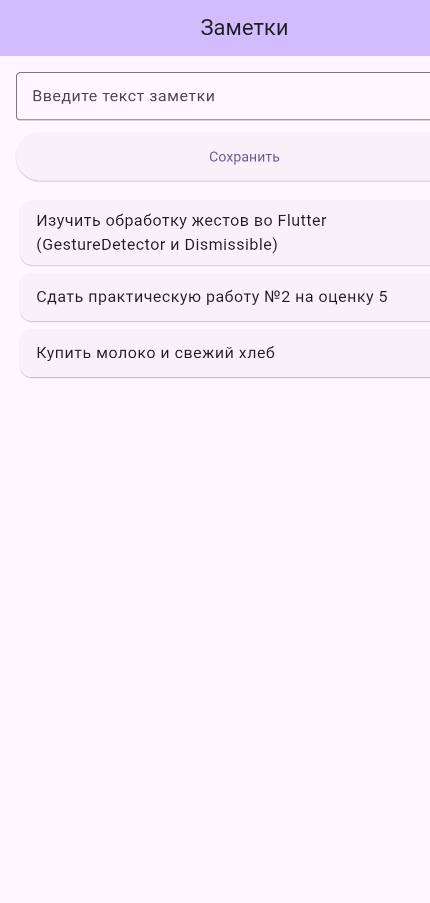
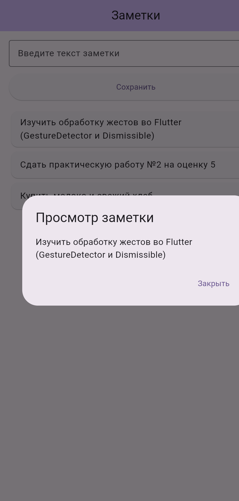
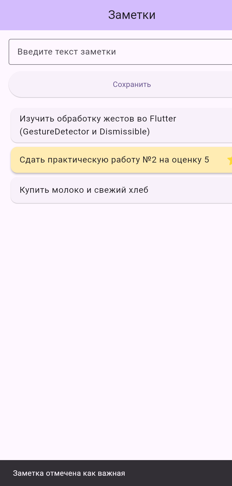
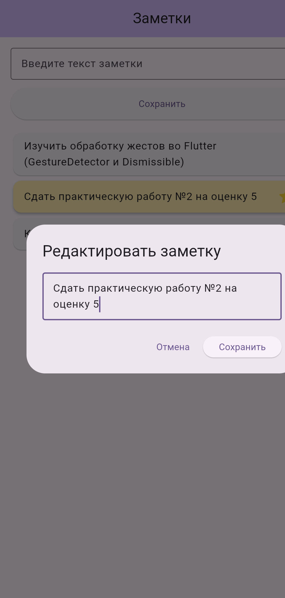
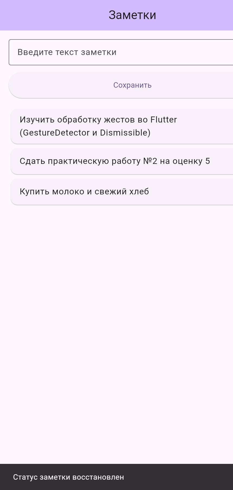
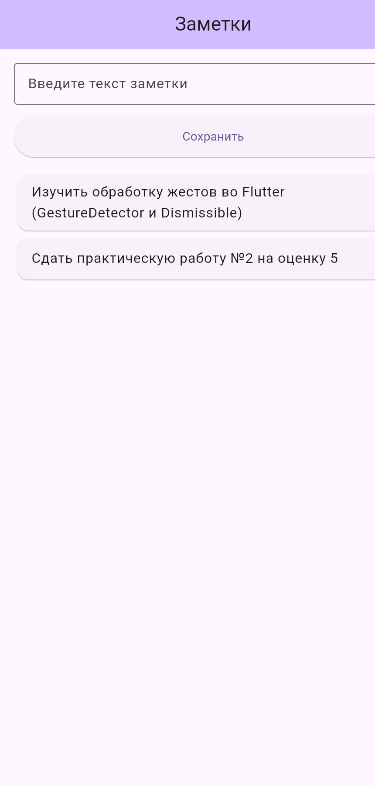

# Практическая работа №3. Обработка жестов во Flutter (GestureDetector и Dismissible)

Данный проект представляет собой мобильное приложение «Заметки» на Flutter с расширенной интерактивностью и поддержкой пользовательских жестов. Работа выполнена на оценку 5 в строгом соответствии с материалами лекции «GestureDetector и обработка жестов во Flutter».

---

## Реализованная функциональность

### Критерии на оценку 4:
- **Обычное нажатие (onTap)** - открывает диалоговое окно для просмотра полного текста выбранной заметки.
- **Двойное нажатие (onDoubleTap)** - отмечает заметку как важную: карточка подсвечивается янтарным цветом, добавляется значок ⭐ и отображается всплывающее уведомление.

### Критерии на оценку 5:
- **Долгое нажатие (onLongPress)** - открывает диалоговое окно редактирования заметки. После сохранения текст заметки корректно обновляется в списке.
- **Свайп влево (swipe left / endToStart)** - удаляет заметку из списка с плавной анимацией смахивания и красным фоновым индикатором удаления.
- **Свайп вправо (swipe right / startToEnd)** - восстанавливает обычный статус заметки, если она была отмечена как важная (снимает отметку ⭐ и возвращает стандартный цвет карточки).

---

## Архитектура и используемые виджеты

В соответствии с рекомендациями лекционного материала (в частности, слайд 14 о разрешении конфликтов жестов):
1. **GestureDetector** - используется для отслеживания дискретных жестов взаимодействия с карточкой заметки:
   - `onTap`: вызов окна просмотра полного содержимого;
   - `onDoubleTap`: установка признака важной заметки (`isImportant = true`);
   - `onLongPress`: открытие модального окна для изменения текста заметки.
2. **Dismissible** - специализированный виджет Flutter для горизонтальных свайпов в `ListView` (рекомендован на слайде 14 во избежание конфликтов между скроллом списка и свайпами карточек):
   - `direction: DismissDirection.horizontal`: поддержка движений влево и вправо;
   - `background`: зеленая панель с иконкой восстановления и надписью «Обычный статус» при свайпе вправо;
   - `secondaryBackground`: красная панель с иконкой корзины и надписью «Удалить» при свайпе влево;
   - `confirmDismiss`: ветвление логики в зависимости от направления свайпа (свайп влево подтверждает удаление, свайп вправо сбрасывает важность и возвращает карточку на место).
3. **Модель данных Note**:
   - `String id`: уникальный идентификатор элемента;
   - `String text`: текст заметки;
   - `bool isImportant`: статус важности заметки.

---

## Пошаговое описание действий и демонстрация результатов

### 1. Главный экран приложения
Пользователь может вводить текст заметки в текстовое поле и нажимать кнопку «Сохранить». Заметки добавляются в интерактивный список `ListView.builder`.



### 2. Просмотр заметки по обычному нажатию (onTap)
При коротком нажатии (`onTap`) на любую карточку открывается модальное окно с заголовком «Просмотр заметки», полным текстом и кнопкой закрытия.



### 3. Отметка заметки как важной по двойному нажатию (onDoubleTap)
При двойном нажатии (`onDoubleTap`) заметка переводится в статус важной: фон карточки подсвечивается мягким янтарным цветом, в правом углу появляется значок ⭐, а внизу экрана отображается SnackBar «Заметка отмечена как важная».



### 4. Редактирование заметки по долгому нажатию (onLongPress)
При удержании пальца на карточке (`onLongPress`) открывается диалоговое окно «Редактировать заметку» с текстовым полем, в которое уже подставлен текущий текст. Пользователь может скорректировать формулировку и нажать «Сохранить». Текст в списке мгновенно обновляется.



### 5. Восстановление обычного статуса по свайпу вправо
При горизонтальном смахивании карточки вправо срабатывает жест свайпа. Заметка сбрасывает статус важной (`isImportant = false`), карточка возвращает исходный стандартный цвет, значок ⭐ убирается, и появляется информационное сообщение «Статус заметки восстановлен».



### 6. Удаление заметки по свайпу влево
При смахивании карточки влево открывается красный фон с иконкой корзины. Карточка удаляется из списка с плавной анимацией виджета `Dismissible`.



---

## Инструкция по сборке и запуску

### Запуск приложения:
```bash
flutter pub get
flutter run
```

### Запуск тестов:
Для проверки корректности работы всех жестов и сценариев (`onTap`, `onDoubleTap`, `onLongPress`, свайп вправо, свайп влево) реализованы автоматические виджет-тесты:
```bash
flutter test
```
