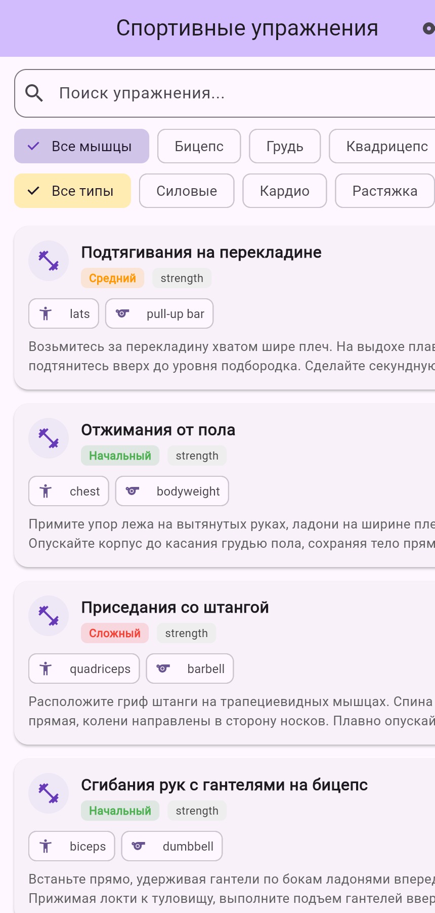
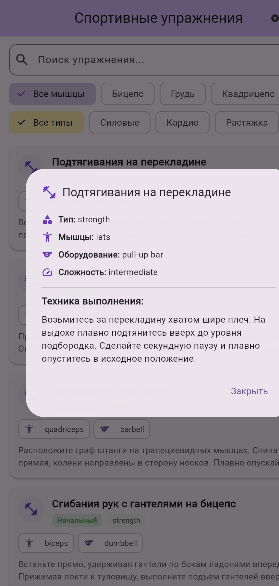
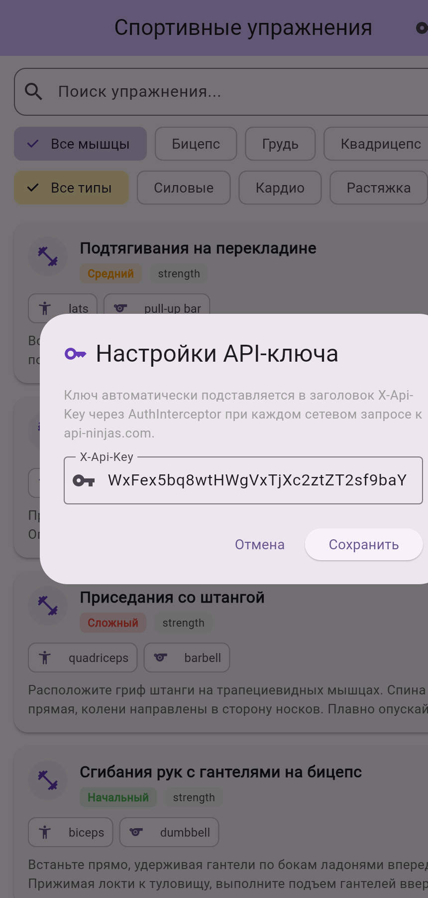
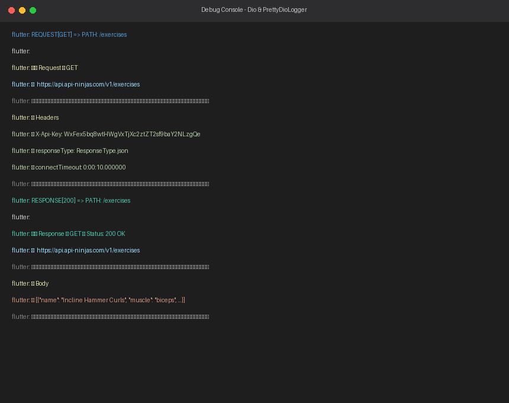

# Практическая работа №4. Работа с сетью во Flutter (Dio, Interceptors, PrettyDioLogger, GetIt)

Данный проект представляет собой мобильное приложение на Flutter для поиска и просмотра спортивных упражнений с интеграцией внешнего REST API (API Ninjas Exercises API). Работа выполнена на оценку 5 в строгом соответствии с требованиями практической работы и материалами лекции «Работа с сетью при помощи пакета Dio».

---

## Реализованные критерии оценки

### Критерии на оценку 3:
- Разработано полноценное мобильное приложение, взаимодействующее с сетью.
- Для отправки HTTP-запросов и обработки ответов используется пакет `dio` (версия 5.x).

### Критерии на оценку 4:
- Создан собственный класс интерцептора `AuthInterceptor extends Interceptor`, который автоматически перехватывает исходящие запросы и внедряет авторизационный заголовок `X-Api-Key` с токеном доступа.
- Подключен и настроен форматированный логгер сетевых запросов и ответов из пакета `pretty_dio_logger` (с отображением заголовков, тела запроса, статус-кодов и ответов сервера).

### Критерии на оценку 5:
- Для выполнения сетевых запросов применен пакет `dio`.
- Реализован класс `AuthInterceptor` для централизованного добавления токена авторизации в HTTP-заголовки.
- Интегрирован интерцептор `PrettyDioLogger` для красивого и информативного вывода сетевой активности в консоль, а также кастомный `LoggingInterceptor`.
- Для управления зависимостями (Dependency Injection / Service Locator) используется пакет `get_it`. Все сетевые клиенты, интерцепторы и сервисы регистрируются в едином контейнере `GetIt.instance`.
- В качестве источника данных используется REST API сервиса `https://api-ninjas.com` (раздел Exercises API: `https://api.api-ninjas.com/v1/exercises`).
- Приложение обладает развитой функциональностью: поиск упражнений по названию, фильтрация по задействованным группам мышц (biceps, chest, abdominals, legs и др.), фильтрация по типу тренировки (strength, cardio, stretching и др.), карточки упражнений с бейджами сложности и инвентаря, модальное окно с подробным описанием техники выполнения, диалог управления API-ключом и механизм отказоустойчивости (fallback) с базовым набором упражнений при отсутствии сети или ключа.

---

## Архитектура проекта и управление зависимостями (GetIt)

Архитектура приложения разделена на независимые слои в соответствии с принципами чистой архитектуры:

1. **Модель данных (`lib/models/exercise.dart`)**:
   - Класс `Exercise` инкапсулирует свойства упражнения: `name` (название), `type` (тип тренировки), `muscle` (целевая группа мышц), `equipment` (необходимый инвентарь), `difficulty` (уровень сложности) и `instructions` (пошаговая инструкция).
   - Фабричный конструктор `fromJson` обеспечивает безопасный парсинг JSON-ответа от API.

2. **Сетевые интерцепторы (`lib/interceptors/`)**:
   - `AuthInterceptor` (`lib/interceptors/auth_interceptor.dart`): перехватывает метод `onRequest` и динамически внедряет заголовок `X-Api-Key` в `options.headers`. Поддерживает динамическое обновление ключа пользователем во время работы приложения.
   - `LoggingInterceptor` (`lib/interceptors/logging_interceptor.dart`): кастомный интерцептор для детального протоколирования URL, метода, статус-кода и ошибок через `debugPrint`.

3. **Сетевой сервис (`lib/services/exercise_service.dart`)**:
   - Класс `ExerciseService` получает экземпляр `Dio` из сервис-локатора `GetIt.instance<Dio>()`.
   - Метод `fetchExercises({String? name, String? muscle, String? type})` выполняет GET-запрос к эндпоинту `/exercises` с передачей query-параметров.
   - Содержит резервный список спортивных упражнений `defaultExercises`, который отображается при отсутствии соединения или невалидном ключе, предотвращая сбои в интерфейсе.

4. **Регистрация зависимостей (`lib/main.dart`)**:
   - Функция `setupService()` регистрирует компоненты в DI-контейнере `GetIt`:
     - `AuthInterceptor` зарегистрирован как синглтон;
     - `LoggingInterceptor` зарегистрирован как синглтон;
     - `Dio` сконфигурирован с `BaseOptions` (базовый URL `https://api.api-ninjas.com/v1`, таймауты подключения и получения ответа по 10 секунд) и цепочкой интерцепторов (`AuthInterceptor`, `PrettyDioLogger`, `LoggingInterceptor`);
     - `ExerciseService` зарегистрирован как синглтон.

5. **Пользовательский интерфейс (`lib/widgets/`)**:
   - `ExerciseList`: основной экран с поисковой строкой, горизонтальным скроллом чипов мышечных групп, фильтрами типа упражнения и списком с поддержкой pull-to-refresh;
   - `ExerciseCard`: интерактивная карточка упражнения с цветовыми индикаторами сложности, тегами инвентаря и предварительным просмотром описания;
   - `ExerciseDetailDialog`: модальное окно с полным описанием техники выполнения упражнения;
   - `ApiKeyDialog`: диалоговое окно для просмотра и ввода собственного API-ключа API Ninjas с возможностью проверки.

---

## Пошаговое описание работы и демонстрация экранов

### 1. Главный экран приложения со списком упражнений
На главном экране отображается каталог спортивных упражнений. Для каждого упражнения выводится карточка с названием, целевой группой мышц, уровнем сложности (beginner, intermediate, expert), требуемым инвентарем и кратким фрагментом инструкции. В верхней панели доступны действия обновления и вызова окна настройки API-ключа.

---

### 2. Поиск и фильтрация по группам мышц и типам
Пользователь может мгновенно фильтровать упражнения по названию через поисковую строку, выбирать целевую мышечную группу с помощью горизонтальной ленты чипов (biceps, chest, abdominals, lats и др.), а также задавать тип тренировки (силовая, кардио, растяжка). Запрос автоматически передает выбранные фильтры в качестве параметров API.

---

### 3. Модальное окно подробной информации об упражнении
При нажатии на любую карточку открывается информационное диалоговое окно `ExerciseDetailDialog`. В нем представлены полные технические характеристики упражнения, а также подробная пошаговая инструкция по правильному и безопасному выполнению движения.

---

### 4. Диалог настройки и изменения API-ключа
По нажатию на иконку ключа в AppBar открывается диалоговое окно `ApiKeyDialog`. Пользователь может ввести свой персональный API-ключ от API Ninjas. При сохранении ключ обновляется в синглтоне `AuthInterceptor` через `GetIt`, и все последующие сетевые запросы автоматически выполняются с новым заголовком `X-Api-Key`.

---

### 5. Логирование сетевых запросов через PrettyDioLogger и Interceptor
Все сетевые вызовы проходят через цепочку интерцепторов `Dio`. Пакет `pretty_dio_logger` выводит в консоль структурированные таблицы с URL запроса, HTTP-методом, переданными заголовками (включая `X-Api-Key`), query-параметрами, телом запроса, кодом статуса ответа и временем выполнения.

